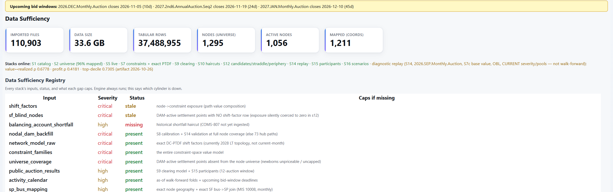
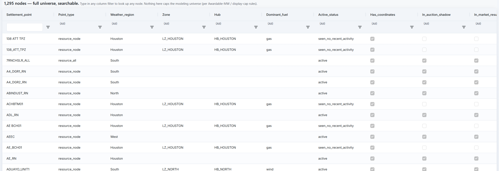
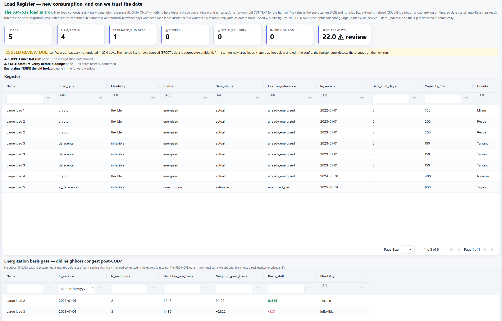
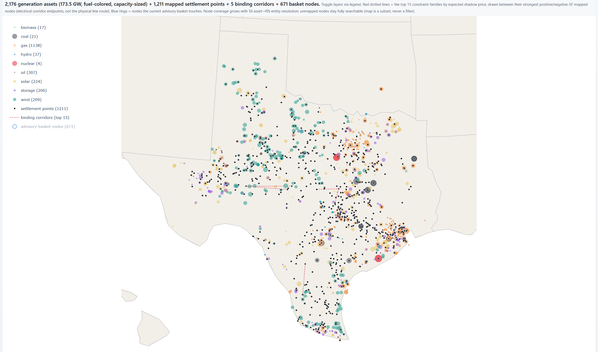
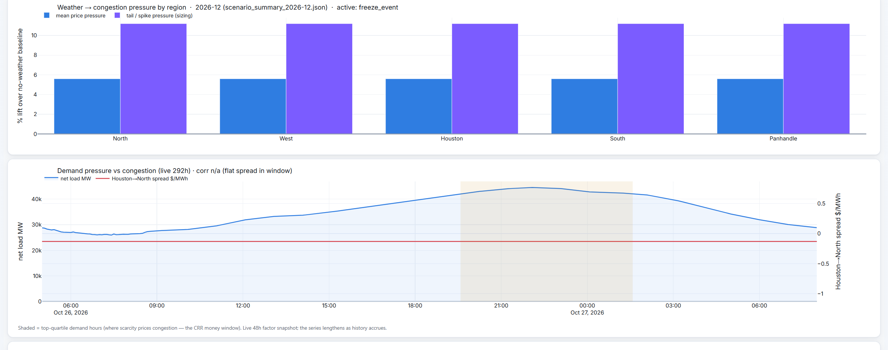
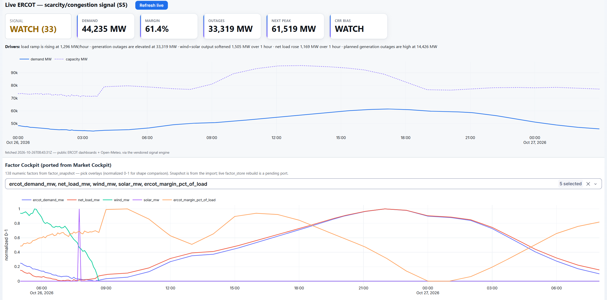

# The desk, chapter 1: Data and coverage

Before the engine prices a path, it has to know what it is standing on: which data arrived, which nodes exist, where
the plants and the large new loads are, and what the grid and the weather are doing right now. These six tabs are
that layer. Two rules run through all of them. The engine always runs, and the desk says which inputs are missing
and what each gap limits. And the display never limits the model: a filter on screen never removes a node from what
the engine prices. Both come from the engine's decision log: fail loud, label, never drop. Every row says where it
came from, and every assumption is a labeled column rather than a buried constant.

Figures and screenshots are from the live desk after the 2026-10-26 nightly run. The desk's header carries research
dials that stay private, so every screenshot starts below the tab strip. Large-load names are replaced with aliases.

---

## Data Sufficiency

**The question:** what data does the engine have, and which part of the model is limited if something is missing?

**What it shows.** The next three auction bid windows and the days left to each. Then the counters: 110,903 imported
files, 33.6 GB, 37,488,955 tabular rows, 1,295 nodes, 1,056 active, 1,211 placed on the map. Then the latest
diagnostic replay headline: on the September 2026 monthly auction, model value tracked realized settlement at
ρ = 0.68. Below that, the registry: one row per input, with its severity, its status (present, missing, stale,
degraded) and what the model loses without it.

**In the screenshot.** Two critical inputs read stale: the incumbent shift-factor file and the list of active nodes
it does not cover. The desk says so on its first tab. The forward months are priced from ERCOT's own auction network
model, with that file as the fallback, and the registry row for each says exactly what the gap caps.

---

## Node Universe

**The question:** what is every priced point on ERCOT's grid, and where did each come from?

**What it shows.** All 1,295 settlement points, searchable by any column: point type (hub, load zone, resource
node), weather region, zone, hub, dominant fuel, active status, whether it has coordinates, whether it appears in
auction data, and its lifecycle. A node is newborn (under a year of day-ahead prices), online, dark (stopped
settling) or without day-ahead history, with its age, days dark and first and last settlement dates. Two provenance
columns say where each row and its fuel came from: the records, or inferred from the name.

**Why it matters.** New nodes are where congestion appears first and where auction history is thinnest, so the
engine tracks every node through its lifecycle. A settlement point active in the day-ahead market but missing from
this universe is itself a registry gap on Data Sufficiency.

---

## Load Register

**The question:** which large new loads, such as data centers, are coming onto the grid, and can their dates be
trusted?

**What it shows.** Each load's type, flexibility, status, energization date and how reliable that date is,
capacity, county, zone and the nearest settlement point. The counters track how many loads are firm and how many
rumored, and how many dates slipped since the last run, went stale or fall inside the bid horizon. A review warning
fires when the list has not been updated for a week.

**Why it matters.** A large load congests the area it plugs into. A six-month CRR on that is a bet that the load
shows up on time, so the date and its reliability are the value. ERCOT's own large-load data is aggregate and
confidential, so the list is built from public news and the register flags every slip automatically.

**The gate before anything earns weight.** The second grid checks each energized load against the market: did the
day-ahead basis at neighboring settlement points shift after it came on? No load signal feeds a model until that
shift is real and not already priced. Today the register is data only, and a contract test keeps it out of every
prediction stage.

---

## Map

**The question:** where is everything?

**What it shows.** 2,176 generation assets (173.5 GW), colored by fuel and sized by capacity, and the 1,211 settlement
points with coordinates. Red dotted lines join the electrical endpoints of the top constraint families by expected
shadow price: the nodes with the strongest positive and negative shift factors, not the physical route of a line.
Node placement comes from the engine's geolocation stage (S06, in the exhibit's
[under-the-hood section](../README.md#under-the-hood-solvers-pipelines-and-invariants)), and coverage grows as
assets are resolved to nodes.

**In the screenshot.** The desk's default view is zoomed in; it is shown zoomed out to all of Texas. One layer (the
nodes touched by the desk's current advisory basket) is switched off.

---

## Weather

**The question:** what do the season's weather scenarios do to congestion, and where is demand right now?

**What it shows.** For a chosen delivery month, the percentage lift that the season's active scenarios put on each
region's congestion, split into the mean and the tail (here December 2026, with a freeze event active). Below that,
live net load against the Houston-to-North spread, with the top-quartile demand hours shaded: the hours where
scarcity prices congestion.

**What else is on the tab.** The engine's seasonal research (how weather regimes tilt the odds of a high-volatility
month), an 85-year record of extreme-weather trends, a library of past weather events with the spread and P&L each
produced, and historical storm tracks near Houston as analogs for drafting a hurricane scenario. These are regime
tilts that size tail bets, never point forecasts or prices. The method is in the exhibit's
[weather inversion section](../README.md#the-weather-inversion); its specific signals stay private.

**WeatherNext 3.** Google DeepMind's 64-member ensemble is the engine's forecast for days 1 to 14, committed on
27 October as the default with its own pipeline stage and tests. The tab shows its mean and P10–P90 band for each
region. On any night the feed is missing or stale, the engine falls back to the previous forecast, labeled, under a
red banner, so the forecast is never blank. Its 73-run backtest is in
[chapter 5](05-the-decision.md#how-a-month-ahead-is-projected).

---

## Live ERCOT

**The question:** how stressed is the grid right now?

**What it shows.** A single system-wide congestion score with its band (normal, watch, elevated, high), demand,
reserve margin, generation outages, the next peak, and a CRR bias read. A sentence names the drivers (load ramp,
outages, the renewable swing, net load). Below, a cockpit overlays any of 138 market factors, scaled to the same
range so their shapes can be compared.

**In the screenshot.** 26 October 2026: score 33 (watch), demand 44,235 MW, margin 61.4%, generation outages
33,319 MW, next peak 61,519 MW.

**What it is not.** A path-level signal. It is the system's mood, from ERCOT's public dashboards and a public
weather feed.
