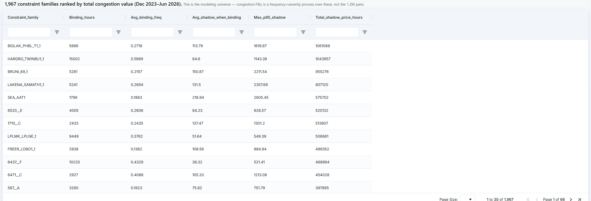
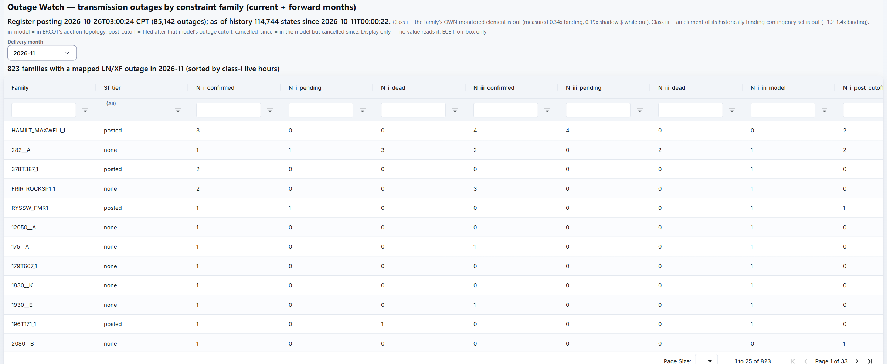
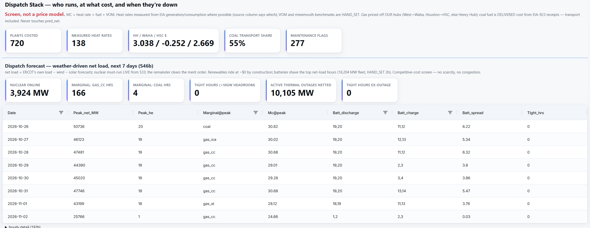
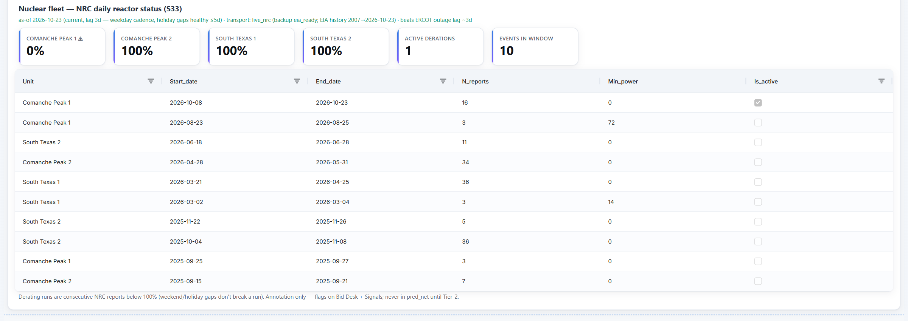

# The desk, chapter 2: Grid physics

A CRR pays the difference in congestion prices between two nodes, and congestion comes from transmission constraints
that bind. So the engine models the market in constraint space: which constraints bind, how hard, when their limits
change, which outages take their lines out, which plants run at what cost, and which reactors are down. These four
tabs are that layer. It is the engine's founding doctrine: model nodes and constraint families, never pairs, and
derive every path from them through the path-value identity. The shift factors in that identity come from a DC power
flow on ERCOT's own auction network model, and a month's model may price nothing until the solver reproduces ERCOT's
published auction results at R² ≥ 0.99 in every time-of-use block (0.99999 or better on the October 2026 auction).
The solve runs contingency by contingency, and every family a month serves is re-checked against ERCOT's newest posted
day-ahead and real-time shift factors; the gates are in the exhibit's
[S07h section](../README.md#s07h-exact-shift-factors-on-ercots-own-auction-model-month-by-month).
The physics behind these tabs (the geolocation of nodes, the DC power flow and shift factors, the outage pipelines)
is in the exhibit's [under-the-hood section](../README.md#under-the-hood-solvers-pipelines-and-invariants).

Figures and screenshots are from the live desk in late October 2026. Every screenshot starts below the
tab strip, because the header carries research dials that stay private.

---

## Constraint Desk

**The question:** which constraints move the money?

**What it shows.** 1,967 constraint families, ranked by total congestion value: binding hours, the share of hours at
the limit, the average shadow price while binding, the 95th-percentile shadow price, and total shadow-price hours
(hours times price). This is the modeling universe. Congestion P&L is treated as a frequency-times-severity process
over these families, not over the 1.2 million possible node pairs.

**Also on the tab.**
- **Regime shifts.** Each family's latest month against its own history, tagged heating up (binding harder than its
  history), cooling, or stable.
- **Stability limits.** A timeline of ERCOT's generic transmission constraints, the stability limits that carry
  outsized congestion value. A month-on-month limit change of more than 5% is recorded as a dated regime event.

---

## Outage Watch

**The question:** which transmission outages hit the constraints the paths depend on, in each forward month?

**What it shows.** ERCOT's outage register as of its latest posting (85,142 outages, with 114,744 dated states kept
since 11 October), joined to constraint families. ERCOT keeps under four days of hourly postings online, so the engine
captures every posting into an append-only history; the register can be rebuilt as it stood at any moment since
capture began, which is what an as-of test of an outage signal needs. For November 2026: 823 families with a mapped line or transformer
outage, from 2,712 family-outage links. Each link is classed:
- **Class i:** the family's own monitored element is out. Measured from June to October 2026, a family binds 0.34
  times as often and moves 0.19 times the shadow-price dollars while its own element is out.
- **Class iii:** an element of the family's usual contingency set is out, and the family binds more often.

Each outage is also tagged against ERCOT's auction model: already in it, filed after the model's cutoff (so the
auction did not price it), or modeled and since cancelled.

**What it is not.** Display only: no value, rank or bid reads it. The screenshot shows the family-level counts; the
outage-level detail stays on the desk.

---

## Dispatch Stack

**The question:** who generates, at what cost, and what is marginal over the next seven days?

**What it shows.**
- **Costs.** Every plant's marginal cost, `heat rate × fuel price + variable O&M` (720 plants costed, 138 with heat
  rates measured from federal generation and fuel data, the rest at labeled defaults), priced off regional gas hubs
  and delivered coal cost.
- **The forecast.** Seven days of net load (ERCOT's load forecast minus its wind and solar forecasts), with nuclear
  taken live from the reactor feed and batteries shaving the top net-load hours. What remains walks the merit order:
  the peak hour each day, the marginal fuel and cost, battery charge and discharge, and the hours with less than
  10 GW of headroom after active thermal outages (10,105 MW netted out in late October 2026).
- **Below the screenshot:** the merit order itself (every plant, cheapest first, with each region's cumulative MW),
  delivered coal cost (the train often costs more than the coal) and each plant's maintenance-prone months.

**What it is not.** A price model. It carries no scarcity pricing and no congestion, and it never touches predicted
profit; it is context for why a region is tight. Two of the three gas prices shown come from an older one-time import
and are marked stale in the engine's own summary.

---

## Radar

**The question:** what is changing before the market prices it?

**What it shows.** Radar is the early-warning screen, in lanes:
- **Routes and nodes.** Routes with little or no auction history, priced from the constraint model; nodes whose
  recent prices have left their own range; and leading indicators mined from 1.9 million node-days for what fires
  before a basis blowout.
- **Physical change.** The nuclear fleet's daily status from the NRC, new generation and transmission projects
  matched to the nodes they will land near, and state environmental upset filings, which often arrive the same day
  while ERCOT's outage reports lag about three days.

Every lane is a screen, labeled as one: candidates, never inputs to predicted profit. Most lanes list specific
routes and nodes, and their contents stay private.

**In the screenshot.** The nuclear lane, as of 23 October 2026: one reactor at 0% and in an active derating run, the
other three at full power, and ten derating events in the window. The NRC's daily report runs about three days ahead
of ERCOT's own outage reporting.
