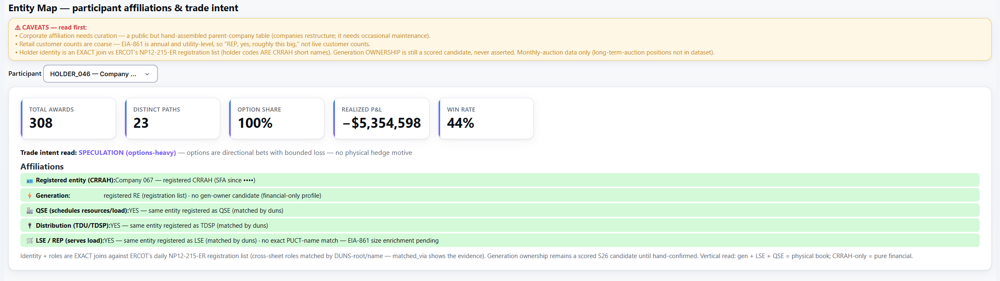
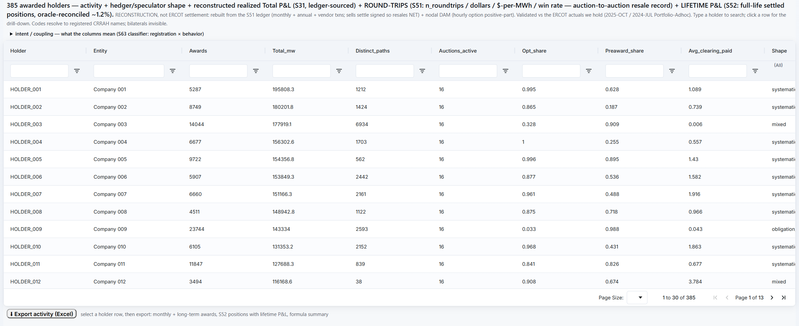
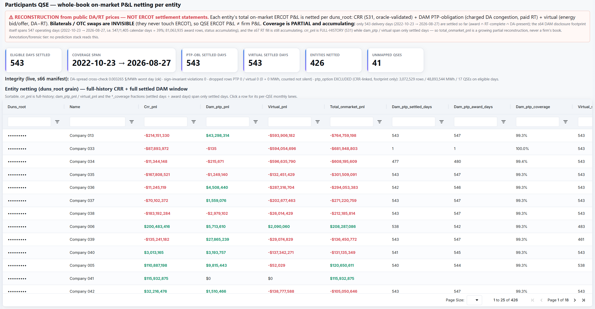
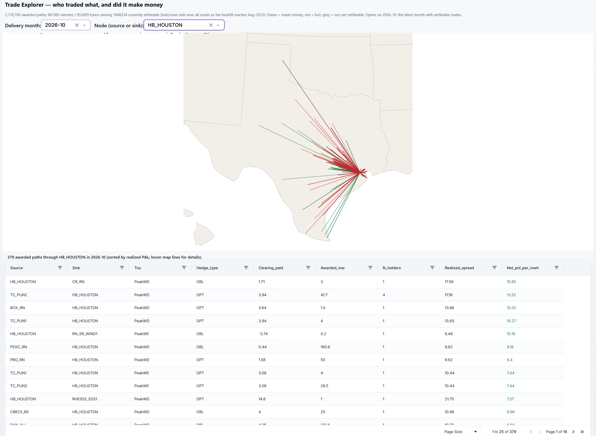
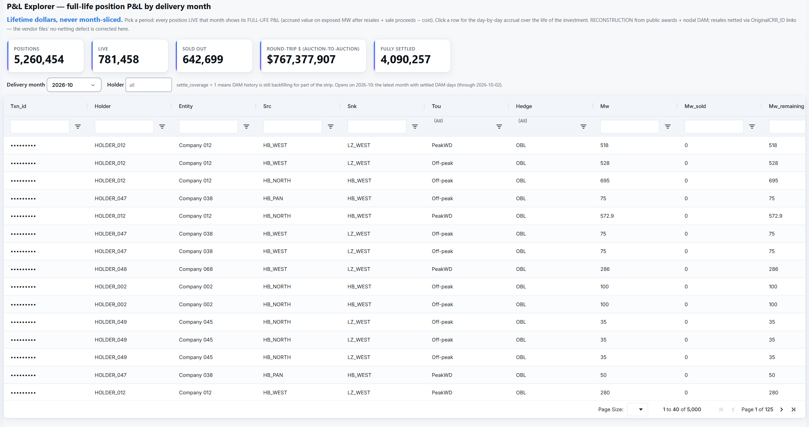
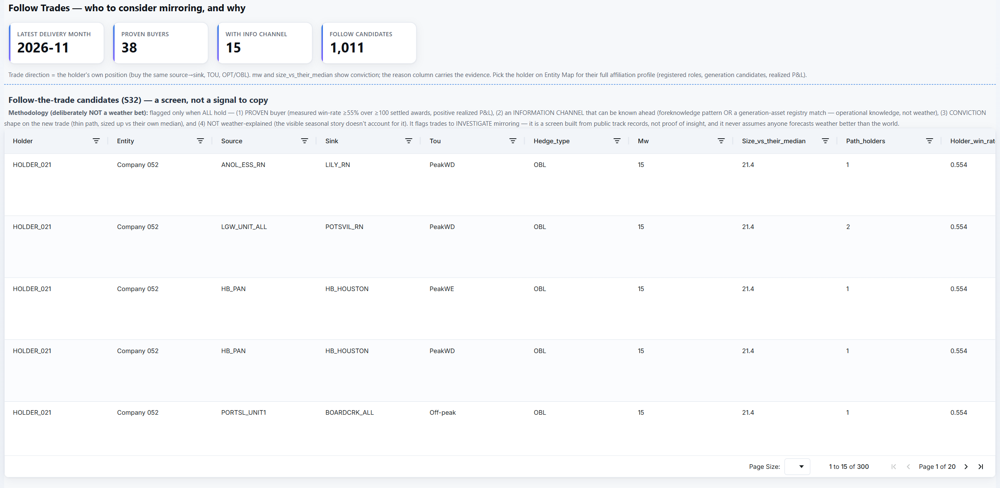
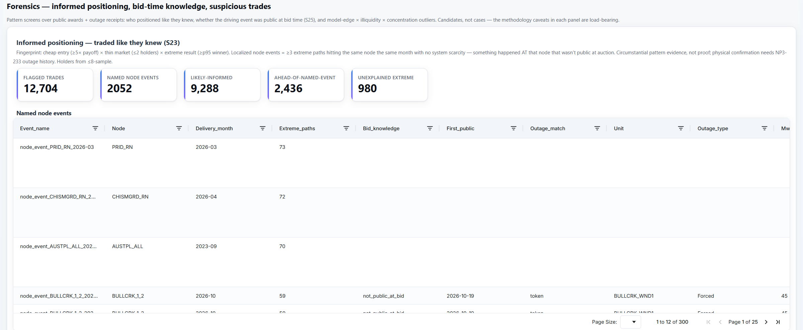

# The desk, chapter 3: Who holds what

ERCOT publishes the CRR market at the transaction level: every auction award and every resale, each with the
holder's account code. These seven tabs turn that record into an account of the market's participants: who each
holder is, what they hold, whether it made money, and who traded as if they knew something the auction did not.

The engine keeps this layer apart from its forecasting. Ownership and affiliation are annotation: no prediction
stage reads them, and the desk joins them only when it renders a screen. Raw buy and sell flow never becomes a model
feature; ledger data can reach a model only as skill-conditioned flows that pass a walk-forward ablation. For the
day-ahead disclosure and whole-book P&L stages (S64 and S66), contract tests fail the suite if a prediction stage
reads them.

Every figure on this page was read from the engine's outputs in late October 2026. The screenshots are from the live
desk the same day. **Company names and holder codes are replaced with aliases** (`Company 001`,
`HOLDER_001`), and DUNS numbers and CRR transaction ids are masked, because either one re-identifies a company through
ERCOT's public lists. The aliasing ran in the page before each capture, against every name on ERCOT's registration
and resource lists, and a capture was refused if any name survived. Three desk labels that are being corrected were
also edited out of the screenshots.

| The layer, at a glance | |
|---|---|
| Ledger | 6,372,890 auction transactions: 3,806,700 from ERCOT's public auction results and 2,566,190 from the earlier vendor extract's 2021–2026 award records (cost basis only; its P&L columns are ignored); 1,112,436 are resales, and every one carries the id of the award it sells |
| Positions | 5,260,454 positions with full-life P&L, accrued day by day on 34.1 million path-day rows |
| Awarded paths | 2,178,760, counted by delivery month: 58 months of history (January 2022 to October 2026) and the 32 future months already sold in long-term auctions (through June 2029) |
| Holders | 474; 441 resolve exactly to a registered company, and those hold 97.4% of buy awards and 98.9% of awarded MW-days ([entity resolution](entity-resolution.md)) |
| Classified | 385 holders, each tagged with what its book is for |

The tabs, in the order a question about a participant runs: [Entity Map](#entity-map) (who are they),
[Participants CRR](#participants-crr) and [Participants QSE](#participants-qse) (what do they hold, and how have they
done), [Trade Explorer](#trade-explorer) and [P&L Explorer](#pl-explorer) (the trades themselves),
[Follow Trades](#follow-trades) (whose trades are worth a closer look), and [Forensics](#forensics) (who traded like
they knew).

---

## Entity Map

**The question:** who is this holder, really?

**What it shows.** Pick any holder code. The tab returns the registered company behind it, every other role that
company holds in ERCOT (scheduling entity, load-serving retailer, generation owner, wires utility), its generation
candidates, and its CRR record: total awards, distinct paths, option share, realized P&L and win rate. A first read of
intent comes from the option share alone. The fuller classifier is on [Participants CRR](#participants-crr).

**How it is built.** Identity is an exact join: CRR holder codes are the short names on the CRR-account-holder sheet of
ERCOT's market-participant registration list (NP12-215-ER). The company's other roles are matched across the list's
other sheets by DUNS root or exact name, and the evidence for each match is recorded. Generation ownership comes from
ERCOT's resource list (NP3-988-ER) and stays a scored candidate, never an assertion. The full method is in
[Entity resolution](entity-resolution.md).

**In the screenshot.** The holder is registered as a CRR account holder, a scheduling entity, a distribution utility
and a load-serving entity: a physical company. Yet its CRR book is 100% options, and it lost money on them. The
option-share rule reads that as speculation, which is why the full classifier weighs registration and behavior
separately.

---

## Participants CRR

**The question:** what kind of player is each holder, and does it make money?

**What it shows.** One row per holder (385): awards, MW, distinct paths, auctions active, option share, average
clearing price paid, trading shape, intent, registered roles, the coupling columns, reconstructed realized P&L and
win rate, the holder's round-trip record (auction-to-auction resales) and its full-life P&L. Click a row for the
drill-down. Export writes the holder's monthly and long-term awards and positions to Excel.

**Intent: what a book is for.** The classifier (S63) fuses ERCOT registration with ledger behavior. Its classes, with
today's counts:

| Intent | Holders | What it means |
|---|---:|---|
| `pure_spec` | 311 | CRR-only, no physical role |
| `load_hedger` | 24 | a retailer hedging its own basis |
| `intermediary_mandate` | 14 | scheduling entity plus CRR account with no assets, that re-buys after big losses (a mandate or sleeve shape) |
| `gen_hedger` | 14 | a generator hedging its own basis |
| `allocated_noie` | 10 | municipal or co-op books receiving allocated (not auctioned) CRRs |
| `integrated_physical` | 9 | generation and retail in one company |
| `unregistered` / `financial_other` | 2 / 1 | |

The behavioral screen behind it is loss-insensitive repurchase: after a big realized loss on a corridor, a speculator
tends to cut it, while a hedger or a mandate tends to hold it, because the exposure it insures did not go away. It is
a screen, not a determination. The data cannot see a firm's actual book, its swaps or its customers.

**Coupling, a separate axis.** Is a CRR book hedging the company's own day-ahead trades, holding the same view twice,
or covering an off-exchange swap? That question gets its own column, measured against ERCOT's 60-day disclosure of each
company's day-ahead awards (S64). A CRR footprint mirrored by an opposite-signed day-ahead footprint reads as an
internal hedge. A large CRR book with no day-ahead footprint is positive evidence of an off-book hedge. The swap
explanation is never fully ruled out, so coupling is a score that carries it as the null.

**One correction worth naming.** The `allocated_noie` class once fired on a name pattern ("city of", "cooperative").
That answers "is this public power", not "does this entity receive allocated CRRs". It now reads ERCOT's own PCRR
eligibility list (NP7-430-M). On the first run, 17 holders moved out of the class, 1 moved in (a utility with no
name signature at all), and 9 agreed. The name flag stays on screen as a comparison column, so guess and report are
always side by side.

---

## Participants QSE

**The question:** across everything a company does on ERCOT's exchange, does it make money?

**What it shows.** One row per parent company (by DUNS root, 426 of them):
`total_onmarket_pnl = crr_pnl + dam_ptp_pnl + virtual_pnl`, with a coverage fraction per lane.

**The settlement math.**
- **Day-ahead point-to-point obligations.** An awarded obligation is charged the day-ahead congestion and paid the
  real-time congestion: `pnl = mw × [(RT_sink − RT_source) − price]`. The award file's clearing price *is* the
  day-ahead congestion (DA_sink − DA_source). The stage proved that to the penny on every awarded row (22.49 million
  when it shipped) before relying on it.
- **Virtual bids and offers.** One injection-signed formula: `pnl = mw × (DA − RT)`. Virtual demand carries negative
  MW, virtual supply positive. The sign invariant is audited across the whole data set before anything settles.

**Coverage is honest about being partial.** A day settles only when the award, a complete real-time record and the
day-ahead price are all present: 543 days so far (23 October 2022 to 27 August 2026), growing nightly. Day-ahead
point-to-point options are excluded from settlement but counted on screen (3.07 million rows, 48.9 million MWh, 17
scheduling entities), so the exclusion is loud. 41 scheduling entities with no parent company are kept as one bucket
with a count, never dropped. The integrity line on the tab is live: worst-day cross-check against the day-ahead spread
$0.003/MWh, zero sign violations, zero dropped rows.

**What it is not.** A reconstruction from public prices, not an ERCOT settlement statement. Bilateral trades and
over-the-counter swaps never touch ERCOT, so a company's ERCOT P&L is not its P&L.

---

## Trade Explorer

**The question:** for a delivery month and a node, who traded what through it, and did it make money?

**What it shows.** Every awarded path touching the chosen node, drawn on a map of Texas: green made money, red lost,
grey not yet settleable. Every node and every source→sink path is mapped; the drawing is illustrative only. The table beneath sorts the same paths by realized P&L per MWh, with the clearing price paid,
awarded MW and the number of holders on each path. Across the data set: 2,178,760 awarded paths, of which 1,646,234
are settleable today (681,983 winners, 953,699 losers). Settleable coverage reaches every node as the nodal price
backfill fills in.

**In the screenshot.** Houston Hub, October 2026: 379 awarded paths. The map is zoomed out to all of Texas, as a user
would with the scroll wheel.

---

## P&L Explorer

**The question:** what did each position live in a month actually make over its whole life, resales included?

**What it shows.** Pick a delivery month. Every position live that month appears at its **full-life** P&L, never a
month slice. Click a row for the day-by-day accrual: obligations can lose and then recover, and options accrue only
on spike days. Across the data set: 5,260,454 positions, 781,458 live, 642,699 sold out, 4,090,257 fully settled,
and $767,377,907 of resolved auction-to-auction round trips.

**The math** (S52, on the S51 ledger):
- an obligation accrues `Σ_h spread_h × MW` over the day's time-of-use hours;
- an option accrues `Σ_h max(0, spread_h) × MW`, the hourly positive part, never a monthly mean;
- cost is `clearing × MW × strip hours`, and sale proceeds are `sale clearing × MW sold × sale-strip hours`;
- lifetime P&L is accrued value on the MW still exposed after resales, plus proceeds, minus cost.

**Why it matters.** This is where resales net out. The pre-API vendor extract left a resold CRR under its original
buyer at full MW. Here a sale truncates the seller's exposure for the months it sold, through the original-award ids
every resale carries. How the reconstruction ties out to ERCOT's own settlement is in the exhibit's
[settlement section](../README.md#settlement-truth-the-vendor-got-it-wrong-the-engine-ties-out-to-actual).

**Guards.** The ledger's invariants are tests, run nightly: no naked shorts (every sell carries an original id and no
buy does), the round-trip identity, the lifetime identity, non-negative daily option accrual, never-negative exposure,
and public records always outranking vendor rows.

---

## Follow Trades

**The question:** whose newest trades are worth investigating?

**What it shows.** A trade is a candidate only when four things hold at once:
1. **a proven buyer**, by its measured win rate over a large number of settled awards, with positive realized P&L;
2. **an information channel** that can be known ahead: a foreknowledge pattern from [Forensics](#forensics), or a
   registry match to generation the holder operates (its own maintenance, upgrades and retirements);
3. **conviction** on the new trade: a thin path, sized above the holder's own median;
4. **not explained by weather**: if the visible seasonal story accounts for the trade, everyone can see it and there
   is nothing to follow.

Candidates are ordered by `win_rate × ln(1 + settled awards) × size ratio`, a transparent ordering, never a
probability. For the November 2026 auction: 38 proven buyers, 15 with an information channel, 1,011 candidate trades.

**What it is not.** A screen to investigate, not a signal to copy.

---

## Forensics

**The question:** who positioned as if they knew, and was the driving event public when the auction cleared?

**Informed positioning (S23).** A trade is flagged when it combines a cheap entry, a thin market and an extreme
result. When several extreme-winning paths hit the same node in the same month with no system-wide scarcity, the
pattern points to something that happened *at* that node, and the event gets a name (`node_event_<node>_<month>`).
Today: 12,704 flagged trades and 2,052 named node events.

**Receipts (S24).** ERCOT's daily unplanned-outage reports (NP1-346-ER) supply the physical cause. 449 daily
snapshots are deduplicated into 61,205 distinct outages and joined to the node events. A unit matches a node exactly
by code or name, or as a scored token candidate, and only if it overlaps the event month and removes at least 20 MW.
226 node events resolve to a specific unit's outage.

**Was it public at bid time? (S25)** A monthly auction clears before its delivery month, so an outage first
published after the month began could not have been priced. But forced outages are surprises by nature: 187 of the
226 resolved events (83%) were not public at bid. So the flag alone is not suspicious. The signal is a holder doing
it repeatedly at high payoff, and the watchlist reads that by participant type: a broad obligation book wins by
coverage, an obligation-focused physical company may be hedging a real position, and a narrow options-heavy book
with no physical assets goes to priority review.

**What it is not.** The tab's own words: candidates, not cases, and never an accusation. It cannot tell skill from
foreknowledge, and it cannot prove who operates a unit.

---

## Under these tabs

| Stage | What it does |
|---|---|
| S19 | marks every awarded path to realized day-ahead settlement |
| S23 / S24 / S25 | informed positioning, outage receipts, public at bid time |
| S26 | the entity registry ([entity resolution](entity-resolution.md)) |
| S31 | per-holder realized P&L, checked against ERCOT's own settlement report |
| S32 | follow-the-trade candidates |
| S51 / S51b / S52 | the transaction ledger, the allocated-CRR ledger, full-life position P&L |
| S63 | participant intent |
| S64 | the 60-day day-ahead disclosure ledger |
| S66 | whole-book on-exchange P&L |

Among the tests behind them, run every night with the rest of the suite: 10 on the ledger and position identities, 6
settlement-oracle tests on per-holder P&L, 17 on the allocated-CRR ledger, 14 each on the day-ahead disclosure and
whole-book P&L stages, 19 on the active-outage lane, 5 on the registry and 4 on the intent classifier (test functions).
