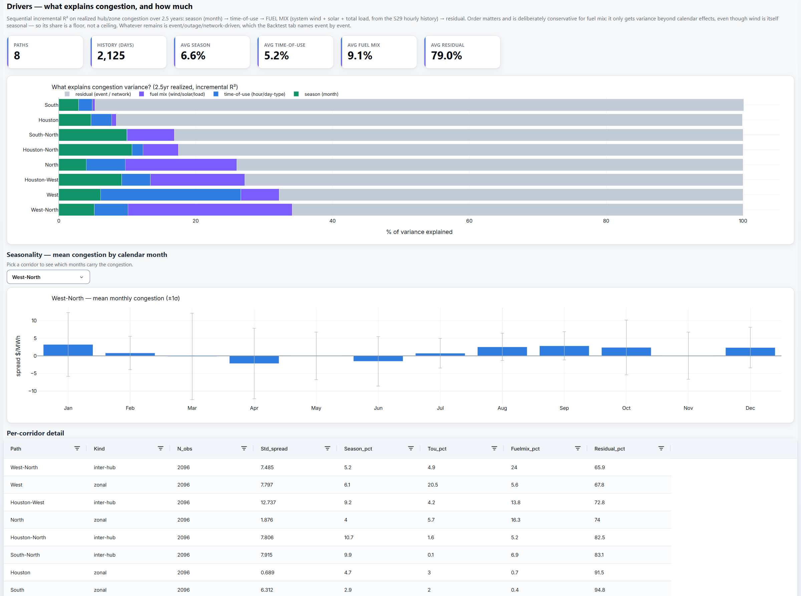
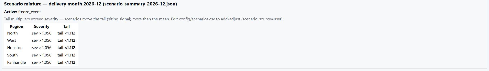
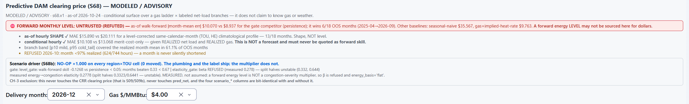
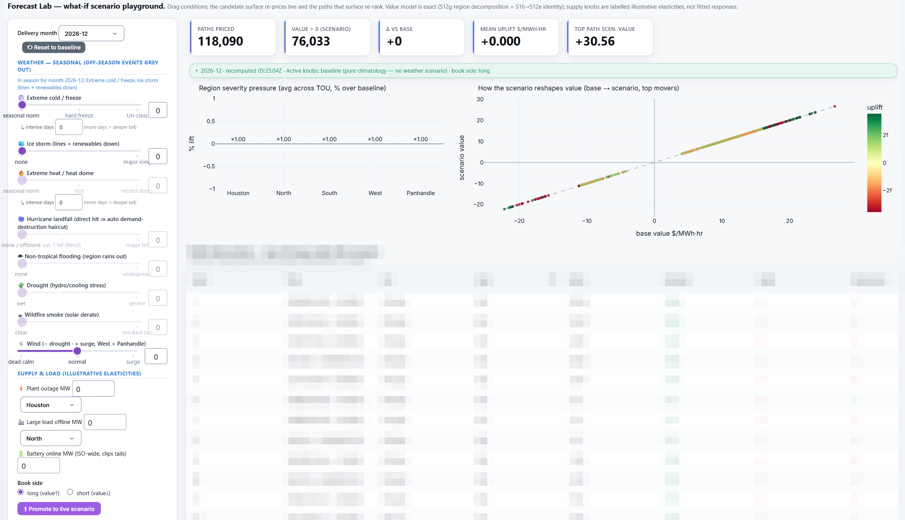
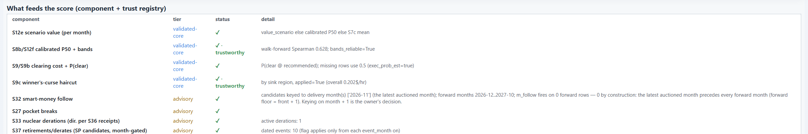
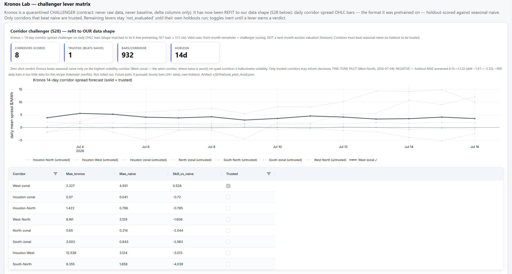
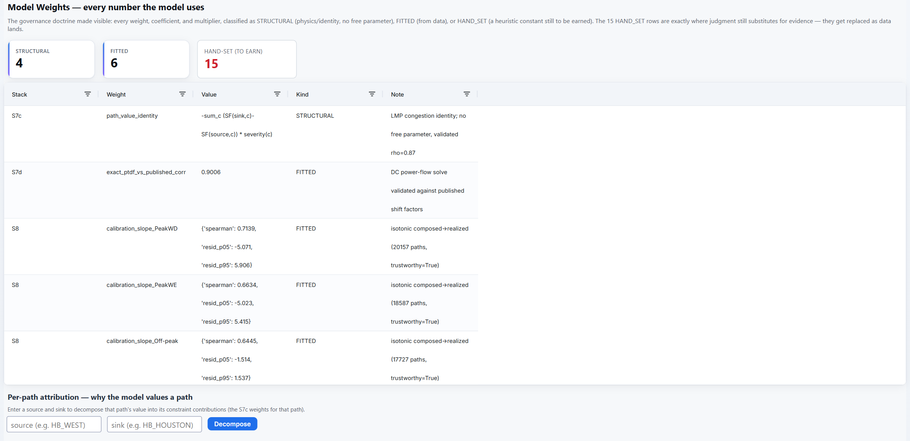

# The desk, chapter 4: Forecasts and scenarios

What is a path worth next month, and how sure is the engine? These eight tabs build the answer and keep it honest.
They break congestion into what explains it, carry the season's weather assumptions, let a person run what-ifs that
re-price every path live, fuse the validated components into one rank, and test every challenger model and every
signal before it may move a dollar. Two doctrines govern every tab here. Weather never prices anything directly;
behavior does, so every weather signal passes through a measured load response. And evidence promotes, humans check:
a forecaster or a signal is promoted by its walk-forward record against a baseline, not by anyone's opinion, and a
person's conjecture enters only signed and bannered in red. The method behind them (macro to micro, how a covariate
earns its way in, the three-tier promotion rules) is in the exhibit's
[macro-to-micro section](../README.md#macro-to-micro-how-a-covariate-earns-its-way-in).

Figures and screenshots are from the live desk in late October 2026. This chapter shows how the forecasts
are built and governed, not what they say: path rankings are pixelated, and the private research dials stay out of
frame.

---

## Drivers

**The question:** what explains congestion, and how much?

**What it shows.** Over 2.5 years of realized hub and zone congestion on 8 corridors, a sequential decomposition of
variance: season, then time of use, then fuel mix (system wind, solar and load), then the residual. On average, season
explains 6.6%, time of use 5.2%, fuel mix 9.1%, and 79.0% is residual. Fuel mix comes last on purpose, so its share is
a floor: it gets credit only for what the calendar does not already explain. Where physics says it should, fuel mix
matters most: on the West-North wind-export corridor.

**What the residual is.** Events, outages and the network. The [Backtest](06-grading-itself.md#backtest) tab names
those months one by one.

---

## Scenarios

**The question:** which weather assumptions sit behind the month's prices?

**What it shows.** The scenario mixture for each delivery month: the active scenarios and the severity and tail
multipliers each puts on every region. Scenarios move the tail more than the mean. Below, an editor for the scenario
table (event type, regions, months, probability by month, duration, severity, tail, source, enabled). Each preset
cites its climatology, and a scenario with no event definition or no measured market link is disabled with the reason
written into the row.

**A model that reports its own failure.** The tab also carries a modeled forward energy price per node, time of use,
net-load branch and gas price. Its forward monthly level loses to simple persistence in walk-forward testing (error
$10.07 against $8.94), so it is labeled untrusted and refuted in red, and its multipliers are gated shut: every one
reads ×1.000. A month with less than 97% of its hours realized is refused rather than scored.

---

## Forecast Lab

**The question:** what if?

**What it shows.** Each path's value is decomposed exactly into contributions by region. A knob multiplies the regions
it affects, and the path's new value is the sum, so all 118,090 paths re-price live as the knobs move. Weather knobs
(freeze, ice storm, heat dome, hurricane landfall, flooding, drought, wildfire smoke, wind) work only in their own
season and are scaled relative to the month's own normal. Freeze and heat are scaled by the measured load response
for that region and month, which is why a November freeze barely moves anything. A hurricane landfall applies the
measured demand loss on the coast automatically. Supply knobs (a plant outage, a large load offline, battery
capacity) are labeled illustrative, not fitted.

**What comes out.** The paths priced and with positive value, the change against the baseline, where the scenario
lands by region, every path's base value against its scenario value, and the paths that climb the ranking
(pixelated here).

**Hidden load, beside the knobs.** For the month picked, a panel shows the hidden-load forecast by load zone and for
the system (P10, P50 and P90 MW above the same month a year earlier), the zone's evidence score, and how much of it is
ERCOT's Batch Zero large loads. It is view-only: no knob moves it, and it reaches path values only through its own
lever, off by default ([chapter 1](01-data-and-coverage.md#hidden-load)).

**Promotion is explicit.** Moving a knob never changes the desks. A person has to promote the knobs to a live
scenario, and then every bid surface shows a red banner naming the scenarios in force until someone disables them.

---

## Ultra Prediction

**The question:** across everything the engine knows, which paths are worth bidding?

**The score.** Expected cleared net per MW is the validated core: path value times hours, minus the clearing cost,
minus a winner's-curse haircut, times the probability of clearing. Advisory signals then scale it through bounded
multipliers:

`ultra_score = expected net + (multiplier − 1) × max(expected net, 0)`

Signals scale only positive conviction, so no signal can rescue a path that is expected to lose money.

**What it shows.** In the screenshot, the registry of what feeds the score, each input with its trust tier. The
validated core: scenario value, calibrated median and bands (walk-forward rank correlation 0.63), clearing cost and
the probability of clearing, and the winner's-curse haircut. Below them, advisory signals such as nuclear derations,
retirements and new supply, each marked advisory and each bounded. The ranked surface itself, with its sizing
advisory, is not shown.

---

## Kronos Lab

**The question:** does a pretrained time-series foundation model beat the engine's simplest baseline?

**What it shows.** The Kronos model, refit to the engine's data shape (daily corridor-spread bars, the format it was
pretrained on), scored on a 14-day holdout (July 2026, its latest scoring) against a seasonal-naive forecast. It beats
naive on one of eight corridors,
the volatile West wind corridor, and only that corridor may speak; on quiet corridors it invents volatility. A
fine-tuning pilot on the West-North corridor made it worse (error 8.16 to 13.52) and was not rolled out. A 45-day probe shows the West skill
holding to about six weeks, from regime persistence rather than price prediction.

**The contract.** Kronos is a quarantined challenger: it never sees raw data, never becomes a baseline, and writes
only delta columns. A second challenger program (a covariate model and Amazon's Chronos-2 under the same trust gate)
appears in [chapter 5](05-the-decision.md#kronos-and-kronos-ii-bid-desks).

---

## Model Weights

**The question:** how does the model decide, and where is judgment still standing in for evidence?

**What it shows.** Every weight, coefficient and multiplier, classified:
- **Structural (4):** physics or an identity, with no free parameter. Example: the LMP congestion identity, a path's
  value as `−Σ_c (SF(sink,c) − SF(source,c)) × severity(c)` over constraints c.
- **Fitted (6):** estimated from data, with the validation shown. Example: the calibration slopes by time of use, each
  with its rank correlation and residual band.
- **Hand-set (15):** heuristic constants still to be earned. Verification raises a "fit me or retire me" card on any
  that ages past three months.

Below, per-path attribution: enter a source and a sink, and the tab shows which constraints that path's value rests
on.

---

## Signals Research

**The question:** which signals actually reach the bid price, and which live only on a research page?

**What it shows.** The honesty check, as the tab calls it. Of 15 catalogued signals, 11 are built, 1 is public and
pullable, and 3 need specialized data. Exactly 1 is in the bid value today: constraint climatology. Forward signals
(new supply, limit changes, scheduled outages) are built and flagged on the desk, but none prices a path until it has
earned it. The tab also carries the falsification studies. For 10 nuclear derations, the plant node's basis moved in
the expected direction in 8 events, but only 1 cleared two standard deviations, so the effect stays descriptive.

No screenshot: the catalog states which signals have proven out, and that stays private.

---

## Tail Hunter

**The question:** which cheap options have paid like insurance?

**What it shows.** Every option path replayed across up to 70 months of realized day-ahead prices, settled on the
hourly positive part. For each: what entry costs at today's clearing, the best month it ever paid and when (the event
receipt), the median and 90th-percentile month, and how often it paid back its entry. A fair-value rank sits beside
the classic cheap-entry screen. Older pairs reach back to Winter Storm Uri, so their best month is a real tail. For
newer pairs it is a lower bound.

No screenshot: the ranked list is a shopping list.
