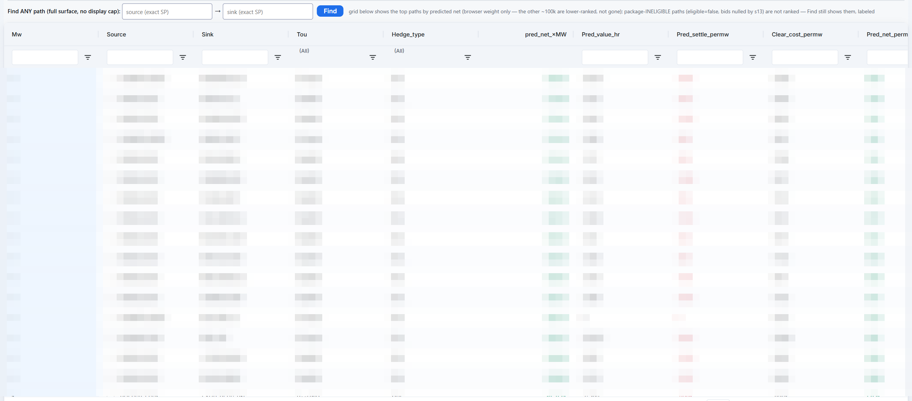
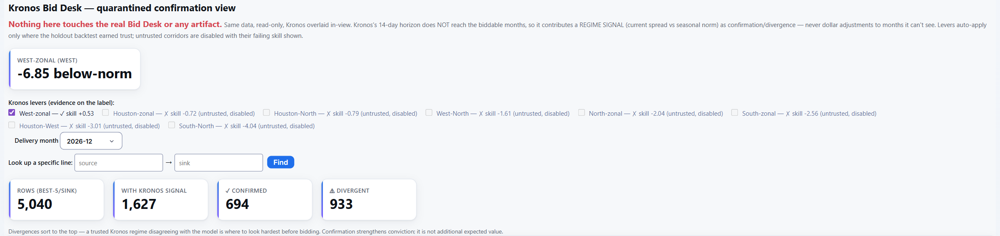
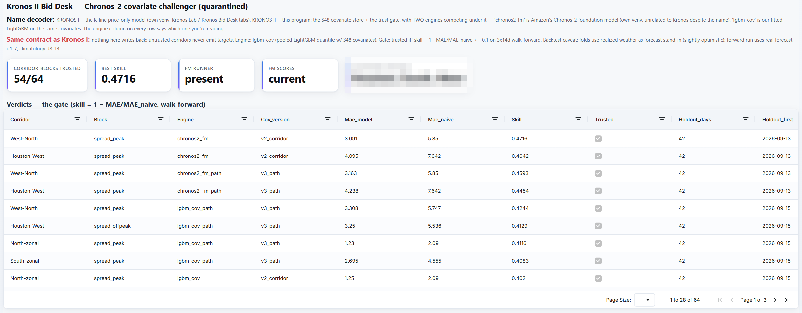
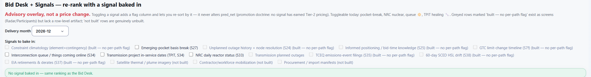
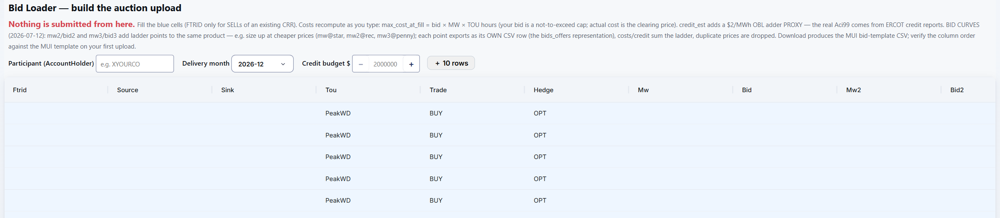

# The desk, chapter 5: The decision

Everything in the first four chapters feeds one surface: what each path is predicted to pay next month, what it costs
at the clearing price, and what to bid. The chapter opens with how a month ahead is projected, where the engine's
statistics meet its physics. Then come five tabs: that surface, two quarantined challengers that check it, a re-rank
that leans on one signal at a time, and the loader that turns picks into ERCOT's upload file. Three rules run through
all of them. The engine prices 1 MW and the person sizes at submittal. Nothing is submitted from the desk. And no
signal moves a dollar until it has earned it.

Figures and screenshots are from the live desk in late October 2026. Paths, prices and bids are
pixelated, and three desk labels that are being corrected were edited out of the screenshots. Two more tabs on this
desk are not shown at all, because they carry the desk's edge.

---

## How a month ahead is projected

**The question:** every page with a forward-month picker (Bid Desk, Ultra Prediction, Forecast Lab, the Kronos
desks) projects any month from December 2026 through October 2027. ERCOT sells next month in its monthly auction and
six-month strips up to three years out in its long-term auctions: this autumn, January to June 2027 closed on 22
October, and July to December 2027 opens on 17 November. What goes into a projection that far out, and how far does
each piece reach?

**The base: history, on that month's network.** For every constraint family, the expected shadow price per hour in a
calendar month and time-of-use block is how often it bound times how hard, from the market's own record: the
same-month average shrunk toward the all-months average by how many years that month has, with the months since
ERCOT's real-time co-optimization went live (December 2025) weighted up. Each forward month is priced on its own
network: the newest ERCOT auction network model that covers it, solved for exact shift factors and checked against
ERCOT's own published auction results, so a transmission addition or a new node in ERCOT's model reaches the months
it is in service. The path-value identity ([the doctrine](README.md#the-doctrine-behind-every-tab)) composes those
constraint values into a value for each of the 118,090 paths. Where a month has no recent auction, its clearing price
is anchored to the same month a year earlier.

**Weather, through behavior.** Weather never prices anything directly; behavior does. In the forward months it enters
as a scenario mixture, through linear and exact algebra: `m_r = 1 + Σ_e p_e (mult_e − 1)` per region. Each event's
probability by month is measured from the climate record (Texas tropical landfalls since 1950, North Texas heat runs,
statewide hard freezes since 1955), and a preset without an event definition or a measured market link is disabled,
with the reason written into its row. The severity and tail multipliers are hand-set, labeled as hand-set wherever
they ride, and on the engine's clock to be fitted or retired. The value is priced on expected weather, not calm.

**What else can add to a forward month.** Signals decide which covariates are included. Each further input has its
own lane into the forward months, and a lane opens only when its effect shows up statistically and holds up long
enough. A new indicator that surfaces is added the same way. The statistics behind the lanes are recomputed every
night, so the evidence for opening or closing one stays current. Ultra Prediction's registry shows every lane and its
state; in late October 2026:
- **Macro weather.** Climate signals earn their place through a 75-year, 2,304-test scan under false-discovery
  control and a region-by-month hindcast gate (the exhibit's
  [macro-to-micro section](../README.md#macro-to-micro-how-a-covariate-earns-its-way-in)), and the survivors size
  tail exposure. A separate switch would let one move the bid value itself. It stays off: tested walk-forward over
  1985 to 2026, it added no explanation over plain climatology.
- **Nuclear.** The NRC's daily reactor report flags derations at each plant's node (one active in late October 2026).
- **Retirements and derates.** Dated, and from each event's month on they nudge the rank through small hand-set
  multipliers; they never change the bid value.
- **New generation and transmission projects.** Mapped to the paths near them and flagged; their multipliers stay
  neutral until a test earns them.
- **Fuel.** Henry Hub gas sits in the registry as context ($3.10/MMBtu). The West stranded-gas regime (a deeply
  negative Waha basis makes West generation cheap) has a multiplier, dormant while its price feed is stale. Texas coal
  stockpiles (110 days of burn, the 96th percentile) drive a stress multiplier that stays dormant while the piles are
  full, and a slot is ready for plant-level stockpiles.
- **Demand.** ERCOT's seven-day zonal load forecast, set against the same month's measured load, tilts the front
  month only.
- **Transmission outages.** Planned outages fill the desk's outage columns; no multiplier reads them until a
  leak-free outage test promotes one.
- **Market structure.** Pocket breaks (a node's basis leaving its own multi-year range), crowding, periphery (the
  same event exposure as a crowded zone, uncrowded) and the deration-risk flag.
- **Large new loads.** Tracked in the Load Register; none feeds a model until the market shows the basis shift
  ([chapter 1](01-data-and-coverage.md#load-register)).

**Conviction only where it is evidenced.** The engine will not manufacture conviction it cannot evidence. The further
out a month, the fewer signals have proven they explain it, so the far months on the picker rest on what has: their
own history, their own network and expected weather, plus dated events such as retirements. A signal that proves
itself for those months earns a lane the same way every other one did. The replays score the front month
([chapter 6](06-grading-itself.md#verification)); the far months have no score yet.

**The cross-check.** A LightGBM quantile model, fitted walk-forward on past node prices, gives each path a median and
bands (rank correlation 0.63 on held-out months). Across the eleven forward months it agrees with the scenario value
at a correlation of 0.40 (January 2027) to 0.75. Where the two disagree widely, the engine's trust ladder favors the
calibrated median, which is fitted and validated, over the scenario overlay, which is a what-if.

**The near term.** Kronos II (below) projects each corridor's spread 14 days ahead with P10, P50 and P90 bands, on
Google DeepMind's WeatherNext 3 ensemble: since 27 October the engine's forecast for all 14 days, where days 8 to 14
used to fall back to climatology. WeatherNext 3 earned the slot in a 73-run backtest over 2024 to 2026. Its
temperature error was 0.8 to 1.3 °F lower than the previous forecast at airport thermometers on days 2 to 7 (day 1 a
tie) and 0.85 to 1.5 °F lower against the engine's own weather record on days 1 to 7, and it beat climatology through
day 14. Its P10–P90 band is labeled uncalibrated on the desk until its warm tail is fixed. Past day 14 the weather
is interpolated from the past: a lever extends the horizon to two months, filling the days beyond the forecast with a
calendar-day climatology of the engine's long weather record (the trailing ten years, ±15 days, the best of 12
variants on a walk-forward test at leads of 15 to 60 days), and covariates join it only through the same gates as
everywhere else. The lever is built and off by default. Every night each engine is also scored lead by lead the way the forward run works, against two baselines,
climatology and persistence. In late October 2026, at 1 to 7 days and at 8 to 14, all four engine versions beat both. Chronos-2 leads, at
skill 0.31 to 0.33 against climatology and then 0.24, ahead of the covariate model at 0.14 to 0.23 and then 0.15 to
0.18. The code records one caveat: the foundation model's test rows use realized weather at every lead, so its
8-to-14-day score runs optimistic. With the lever on, leads of 15 to 30 and 31 to 60 days are scored the same way, so
the engines are tested against each other as the projection runs out.

| Horizon | Weather | Projection | What it may do |
|---|---|---|---|
| Days 1 to 7 | WeatherNext 3 forecast | Kronos II corridor spreads, P10 to P90 | Flag and re-sort; never prices |
| Days 8 to 14 | WeatherNext 3 forecast (the month's climatology before 27 October) | Kronos II | Flag and re-sort; never prices |
| Days 15 to 60 | Calendar-day climatology | Kronos II, behind a lever that is off by default | Scored by lead when on |
| The biddable months | Scenario mixture from the climate record | Constraint history through shift factors; the calibrated median as a cross-check | Prices the bid |

---

## Bid Desk

**The question:** what is each path worth next month, and what should be bid?

**What it shows.** For a chosen delivery month (eleven are built, December 2026 through October 2027), every path's
predicted economics per MW: 118,090 rows a month, one per source, sink, time-of-use block and product. The value side
is the month's predicted path value times the block's official hours. In late October 2026 the scenario value priced every
row; the calibrated median and seasonal climatology are the fallbacks. The cost side is the expected clearing price
times the same hours, anchored to the latest auction for 77,435 rows and to the same month a year earlier for 40,655.
Options settle on the hourly positive part only, so the most an option can lose is its premium. Every column is the
selected month's own economics, and a set of basis columns records where each number came from.

**The bid.** Beside each path: the bid that maximizes expected cleared profit against the modeled clearing
distribution, with its probability of clearing; an older rule of thumb, labeled as a heuristic; and the winner's-curse
haircut, which rides beside the bid and never changes it. The auction is uniform-price, so the bid is a cap and the
cost is the clearing price. The engine therefore solves `b* = argmax_b P(C ≤ b) · (V − E[C | C ≤ b])`, where V is the
month's predicted settlement and P(clear) blends the path's own clearing history with its region-pair family's, weighted
by how much evidence the path has (the math is in the exhibit's
[bid section](../README.md#s09-to-s13-the-bid-as-a-decision-under-a-clearing-distribution)). A path that sinks at a
resource node is valued under that node's settlement-deration cap, and wind and solar nodes are capped at zero
upside. Each row also carries a one-line thesis (which region's
congestion the path bets on, whether the month's weather helps, any warnings), how crowded the path is, the
transmission outages on its top constraints, new supply near the sink, and a collateral estimate. Three hidden-load
labels (the sink zone's forecast for the month, its evidence score and the forecast's basis) are joined when the page
loads; they change no dollar ([chapter 1](01-data-and-coverage.md#hidden-load)).

**Sizing stays human.** Editing a row's MW recomputes predicted net times MW as you type. A fill curve measured from
replayed auctions shows how the awarded share falls as size grows. It is informational: nothing filters or prices on
it.

**Finding and choosing.** The grid shows either the top paths by predicted net or the best five into every node.
"Find any path" searches all 118,090 rows, including the paths the auction package makes ineligible, labeled as such.
Below the grid, an optimizer proposes an advisory basket under ERCOT's limit of about 2,000 transactions per auction
and a per-sink cap (in late October 2026, 2,000 paths from 4,000 candidates), and lists the near-misses just outside it. It
decides nothing. The tab's own header calls the surface "a forecast, not a guarantee."

---

## Kronos and Kronos II bid desks

**The question:** does an independent model agree with the main one, and where should a person look harder before
bidding?

**Kronos Bid Desk.** The same Bid Desk rows, read-only, with the Kronos challenger from
[chapter 4](04-forecasts-and-scenarios.md#kronos-lab) laid over them. Kronos sees 14 days ahead, which does not reach
the months being bid, so it contributes a regime signal (the corridor's current spread against its seasonal norm) as
confirmation or divergence, never a dollar adjustment. Only a corridor that beat a naive forecast on holdout may
speak. On the latest Kronos scoring (a 14-day holdout in July 2026) that is the West corridor alone, at skill +0.53;
the other seven are switched off with their failing skill on the label, from −0.72 to −4.04. For December, 1,627 of
the 5,040 best-per-sink rows carry a Kronos signal: 694 confirm the main model and 933 diverge. Divergences sort to
the top, because a trusted regime that disagrees with the model is where to look hardest. Confirmation adds
conviction, not expected value.

**Kronos II.** A second challenger program under the same contract, this time with covariates: a 14-day forecast of
corridor spreads from weather, gas, outages, nuclear status and load. Two engines compete under one trust gate:
Amazon's Chronos-2 time-series foundation model (unrelated to Kronos despite the name) and the engine's own LightGBM
quantile model on the same covariates, each in a corridor-level and a per-path version. A corridor block (8 corridors,
peak and off-peak) is trusted only if `skill = 1 − MAE / MAE_naive ≥ 0.10` across three 14-day walk-forward folds, 42
held-out days from mid-September to late October 2026. In late October 2026, 54 of 64 engine-corridor blocks passed. The
foundation model posts the best single score (0.47, on the West-North peak spread). The covariate model passes more
blocks (31 of 32, against 23 of 32), but the gate scores it one day ahead from realized prices; scored lead by lead
the way the forward run works, the foundation model leads (see above). The tab states its own caveat: the folds use
realized weather in place of forecasts, so the scores run slightly optimistic.

**What Kronos II may do.** Flag and re-sort the best-per-sink rows whose region has a trusted corridor running hot
against climatology. Predicted net is untouched and nothing is written back. In the screenshot, the verdict grid is
shown in full and the current hot-regions read is pixelated.

---

## Bid Desk + Signals

**The question:** how does the ranking change if a person leans on one signal?

**What it shows.** An advisory overlay, not a price change. Ticking a signal adds a flag column and re-sorts by it.
Predicted net never moves, because no signal has yet earned a place in the price (the promotion rules are in the
exhibit's [macro-to-micro section](../README.md#macro-to-micro-how-a-covariate-earns-its-way-in)). Four signals can
be toggled today: emerging-pocket basis breaks, the NRC's daily reactor status, the interconnection queue, and
transmission projects coming into service. The checklist marks the rest as built elsewhere on the desk with no
per-path flag yet, or as not built.

---

## Bid Loader

**The question:** how do picks become ERCOT's upload file without breaking the credit budget?

**What it shows.** A participant code, the delivery month and a credit budget, then one row per bid: source, sink,
time of use, buy or sell, option or obligation, MW and bid, with up to two more price points for the same product
(more MW at cheaper prices). Each price point exports as its own row. Costs recompute as you type: the most a bid can
cost if it fills is bid × MW × block hours (the bid is a not-to-exceed cap; the actual cost is the clearing price),
and a credit estimate adds a proxy adder for obligations. Beside each row sits the engine's own view of that exact
path, so a typo stands out. The banner totals the estimated credit against the budget and turns red, "over budget,
trim before export", when it is exceeded. The download is the bid-template CSV for ERCOT's CRR system.

**What it is not.** A submission tool. Nothing leaves the desk; a person uploads the file in ERCOT's system.
