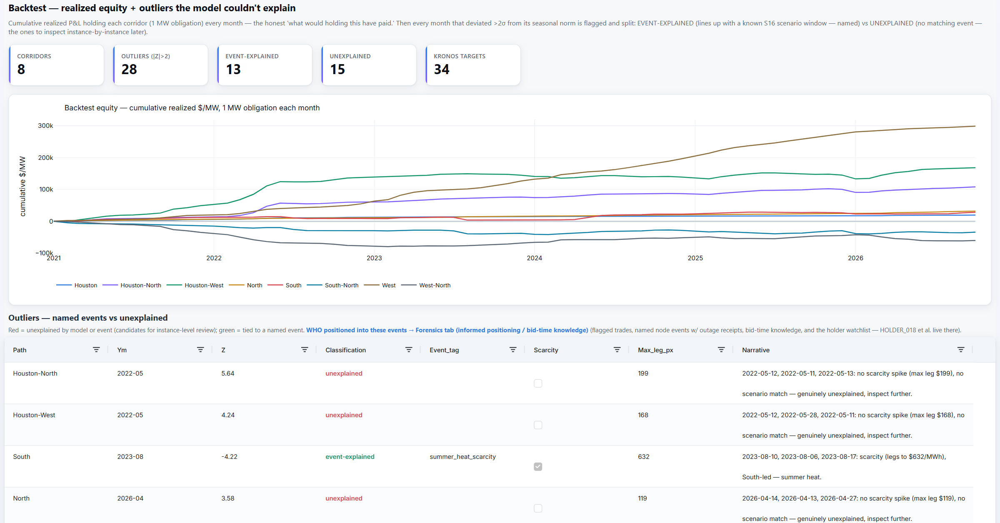
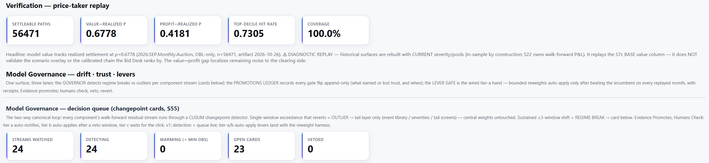
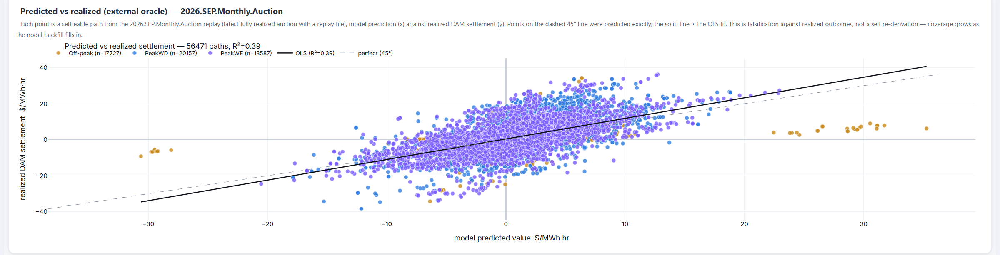
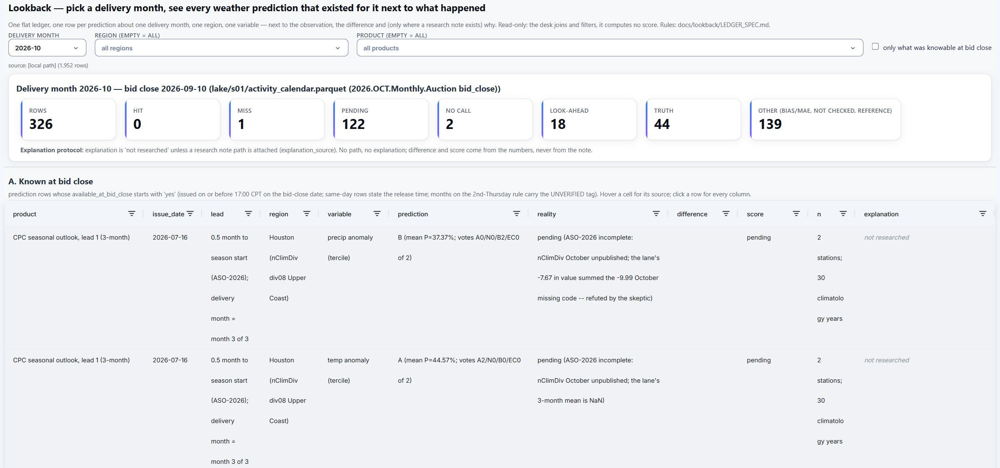

# The desk, chapter 6: Grading itself

A forecast is only worth what it does against what actually settled. These four tabs hold the engine to that: what
holding each corridor would really have paid, how the model's values compared with settlement in a replayed auction,
which parts of the model have drifted, and what every weather forecast said about a month next to what happened.
Where the desk can be wrong, it says so on screen. The engine ranks its own evidence: an external oracle (realized
settlement) beats falsification, which beats invariants, which beat the engine re-deriving its own numbers, which
does not count as verification. Every number on these tabs carries the rung it earned.

Figures and screenshots are from the live desk in late October 2026. One desk label that is being
corrected was edited out of the Backtest screenshot.

---

## Backtest

**The question:** what would holding each corridor have actually paid, and which months does nothing explain?

**What it shows.** Cumulative realized P&L from holding each of 8 hub and zone corridors as a 1 MW obligation every
month for 70 months, back to early 2021. Then every corridor-month more than two standard deviations from its seasonal
norm is flagged and split: event-explained (a scarcity spike in a winter or summer month, or a match with a scenario
window for that month and region, named in the row) or unexplained. Of 28 such months, 13 are explained and 15 are not. The unexplained ones are listed for review
one by one, and the Forensics tab in [chapter 3](03-who-holds-what.md) shows who was positioned into them.

**Also on the tab.** A per-corridor table (months, total realized, share of months positive) and a path inspector:
the monthly realized spread for any source and sink, with a daily drill for any month. Any number cited in analysis
can be reproduced there.

---

## Verification

**The question:** does the model work, and is any part of it drifting?

**The replay.** The September 2026 monthly auction, rebuilt and scored against realized settlement: 56,471
settleable paths, model value against realized value at ρ = 0.68, model profit against realized profit at ρ = 0.42,
and a 73% hit rate in the top decile. The tab labels its own limits: this is a diagnostic replay, rebuilt with today's
settings and so in-sample by construction, and it scores the base value, not the scenario overlay the Bid Desk ranks
by. The gap between the value and profit correlations points at the clearing side as the remaining noise.

**Predicted against realized.** Every settleable path from that replay, the model's predicted value against realized
day-ahead settlement, with the 45° line and the fitted line (R² = 0.39). Below it on the tab: a daily scorecard
(1,122,390 path-days, 48% realized above forecast, mean absolute error $2.54 per hour), and the paths the model ranked
low that paid and ranked high that did not.

**Options, scored separately.** Options settle on the hourly positive part, so they are replayed on their own: profit
rank correlation 0.57 and a 30% top-decile hit rate. Buying every option loses money, at −$0.77 per hour, so options
pay through a few large hits, not per-path accuracy. In the same replay, the profit-maximizing bid beat the rule of
thumb, which the tab reads as one auction's verdict.

**The governor.** Every component's walk-forward error stream runs through a changepoint detector (CUSUM, reference
value 0.5σ, decision limit 4σ, detection from 8 observations): 24 streams watched, 23 open cards. A single spike of
|z| ≥ 3 that reverts is an outlier and goes to the tail layer only; a shift that holds for three windows is a regime
break and becomes a card with its evidence, a proposed action and its blast radius
(which parts of the model consume it). Cards come in three tiers: tier a notifies, tier b applies itself after a veto
window, and tier c waits for a person. Two examples from late October 2026:
- **The unexplained share is rising.** The share of residual the model cannot attribute shifted up for three windows.
  The proposed action: route what is new through feature search and news tagging rather than re-weighting the
  model. Tier c.
- **Fit me or retire me.** Five hand-set weights have been unchanged for more than three months (106 days), and each
  has a card asking that it be fitted from data under a walk-forward gate or retired with a dated note.

**The lever gate.** A bounded setting changes on its own only after it beats the incumbent on every replayed auction:
selected on all but the latest month, then confirmed on that untouched month. It has changed settings three times
since July, each logged with its receipt (the holdout step was added on 17 July, after the first). Every trust flip in the engine goes into an append-only promotions ledger:
More than 100 items hold trust, from 6,193 logged promotions and demotions.

**Also on the tab.** Universe reconciliation (does each path still exist next month: removed nodes, newborns,
renames), with a re-inspection queue of 4,341 removed paths that something live still references.

---

## Lookback

**The question:** for any month, what did every weather forecast say, and was it right?

**What it shows.** One flat ledger: one row per prediction about one delivery month, region and variable, next to the
observation, the difference and a score. A filter keeps only what was knowable at the bid close. For October 2026
(bid close 10 September), 326 rows: no hits and 1 miss so far, 122 pending, 2 no-calls, 44 truth rows, 139
reference rows (bias and error, not hit-scored), and 18 issued inside the month, marked look-ahead and never scored. An explanation appears only where a research note is attached; without
one, the row says "not researched."

**The sections.** What was known at the bid close; what was issued after it; what happened (station truth); the
engine's own 7-day forecasts, with bias and error by lead day; the price side; and a scorecard across months. The
scorecard sets each product's hit rate beside a constant "Above normal" baseline. For September 2026, NOAA's CPC
monthly outlook hit 10 of 12 scored calls at its end-of-month update and 10 of 10 at first issuance, against 60% for
the constant call. Samples this small are reported, not trusted.

**The price side.** The replay's profit rank correlation for each of the last 14 monthly auctions (in-sample, like
the replay on Verification), from 0.13 (August 2025) to 0.81 (June 2026), with September 2026 at 0.42. The spread
across months is the record, not the best month.

---

## Feedback

**The question:** how does someone else review the desk without changing it?

**What it shows.** The desk also runs as a shared, read-only view. There, every button that would change the engine
(a scenario edit, a promoted what-if, a governor decision) records a proposal instead: what was asked, with its
payload. The colleague can also send a question or a note, tagged with where it applies. On the owner's desk this tab
lists them, newest first. Nothing is applied until the owner does it. The shared view's only write is that log. It
does not serve Outage Watch (ERCOT's outage register is restricted infrastructure information and stays on the
owner's machine), blanks the outage
columns on the Bid Desk, and turns off the bid-upload and basket downloads.

No screenshot: the log is empty on the owner's desk today.
