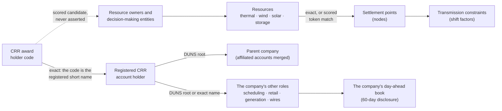

# Entity resolution: from a holder code to a company, its roles and its assets

A CRR award names its holder by an account code. To know who holds what (a generator hedging its own plant, a
retailer hedging its load, a fund with no physical position at all) the engine has to turn that code into a company,
find the company's other roles in the market, and connect it to physical assets on the grid. This is the layer behind
[chapter 3](03-who-holds-what.md) of the desk. Figures are from the 2026-10-25 registry build and the 2026-10-26
nightly run.

## The sources

All public, posted daily by ERCOT or the Texas PUC:

| Source | What it gives | As of 2026-10-25 |
|---|---|---|
| ERCOT market-participant registration list (NP12-215-ER) | every registered company by role, on six sheets: CRR account holder 525, scheduling entity (QSE) 1,632, resource entity 1,117, load-serving entity 473, distribution utility (TDSP) 178, and IMRE 357 | 4,282 registrations |
| ERCOT resource list (NP3-988-ER) | each generation or storage resource, its type, its owning entity and its decision-making entity, with DUNS | 1,713 resources; 765 owners; 486 decision-making entities |
| PUCT certified retail electric provider directory | retail certification, used to size a load-serving entity | 297 providers |

Contact-person columns on the registration list are dropped at ingest. The engine has no use for them, and it keeps
personal data out.

## Tier 1: the exact join

ERCOT's CRR holder codes are the short names on the registration list's CRR-account-holder sheet. So the first step
is an exact join, with no guessing: code → registered company.

From there, the company's other roles are found on the list's other sheets, matched by **DUNS root** or by exact name:
- **The DUNS root is the first nine digits.** ERCOT pads DUNS numbers to 13 digits with trailing zeros on some sheets
  and stores the bare nine on others, so matching on the full field silently misses.
- **Names are cleaned first:** the registration-type suffixes ERCOT appends, such as "(RE)", are stripped.

Each match records its evidence (for example `QSE:duns, LSE:name`), so a reader can see why the desk says a company is
also a scheduling entity or a retailer.

**Coverage.** Of the 474 holders in the transaction ledger, 441 resolve exactly to a registered company (93%). They
hold 97.4% of buy awards and 98.9% of awarded MW-days. The rest are codes absent from the current list.

**The vertical read.** Roles together say what kind of book a holder runs. Generation, retail and scheduling in one
company is a physical book. A CRR account with no other role is a purely financial one. That registration prior feeds
the participant-intent classifier on [Participants CRR](03-who-holds-what.md#participants-crr).

## Tier 2: scored candidates, never assertions

Codes missing from the current list (accounts that left the market or were renamed) get candidate matches instead:
1. The code's stem (codes look like `X` plus a name stem, with trailing digits dropped) is compared with the name
   tokens of every resource owner, decision-making entity and registered company.
2. Common words that would match everything are removed first: LLC, ENERGY, POWER, SOLAR, WIND, STORAGE and others.
3. A candidate needs a shared prefix of at least four characters. The three best per holder are kept, labeled strong
   (six or more characters) or weak.

226 holders carry candidates. The desk shows them as candidates. A mapping turns "confirmed" only when a person
confirms it by hand, in a file the engine never writes.

## From companies to assets to the grid

Generation ownership is a scored candidate, never a fact: the resource list names a resource's owner and
decision-making entity, but connecting those to a CRR holder still runs through the candidate tier unless the
registration list makes the link exact.

Resources reach the grid through their settlement points. The engine joins units to nodes in two ways:
- **Exactly**, when the node equals the unit code or the resource name.
- **As a scored token candidate**, on the longest shared token prefix of at least five characters.

Every row carries the method that produced it. In the open-outage table built on 2026-10-25 (266 outages on 253 units,
16,755 MW out, 442 MW of it storage), the matches are 53 exact, 156 token candidates, 8 ambiguous and 49 unmatched.
None of them is hidden.

From a node, the engine's power-flow layer gives the shift factor to every transmission constraint: how much of a
node's injection flows over each line. Those methods are in the exhibit's
[S06 and S07d sections](../README.md#under-the-hood-solvers-pipelines-and-invariants).

## The company's other book

A CRR position can hedge the company's own day-ahead trading, a bilateral swap with a client that never touches
ERCOT, or nothing at all. ERCOT publishes every scheduling entity's day-ahead awards on a 60-day lag. The engine
ingests that disclosure (S64) and nets each parent company's whole on-exchange book (S66) by DUNS root, so the CRR
book and the day-ahead book of one company can be read side by side:
- **A CRR footprint mirrored by an opposite-signed day-ahead footprint** is consistent with an internal hedge.
- **A large CRR book with no day-ahead footprint** is positive evidence of an off-book hedge.
- **The swap explanation is never fully ruled out**, so coupling is a score that carries it as the null.

The same DUNS root merges a company's several CRR accounts into one book wherever the desk groups by affiliate.

## Why it is built this way

- **Annotation, not a model input.** The registry lives apart from the modeling data. No prediction stage reads it;
  the desk joins it only when it renders a screen. Ownership is a fact about the world that changes and is often
  uncertain, so it is kept out of the models.
- **Scored, never asserted.** Every inferred link carries its method and confidence, and only a person can confirm
  one.
- **Reports over guesses.** Where ERCOT publishes the answer, the report replaces the heuristic. The allocated-CRR
  class used to fire on a name pattern ("city of", "cooperative"). It now reads ERCOT's own eligibility list
  (NP7-430-M). On the first run 17 holders moved out of the class and 1 moved in, a utility with no name signature at
  all.
- **Never fatal.** The registry refreshes nightly. If a source cannot be fetched, the last good copy stands and the
  run goes on.

**Tests.** 5 on the registry, 4 on the intent classifier, 17 on the allocated-CRR ledger and 19 on the outage-to-node
lane (test functions, run nightly with the rest of the suite).
